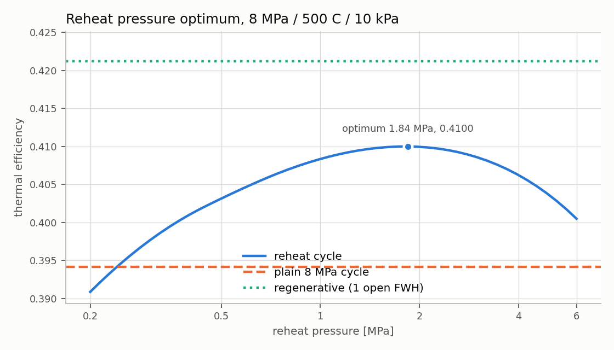
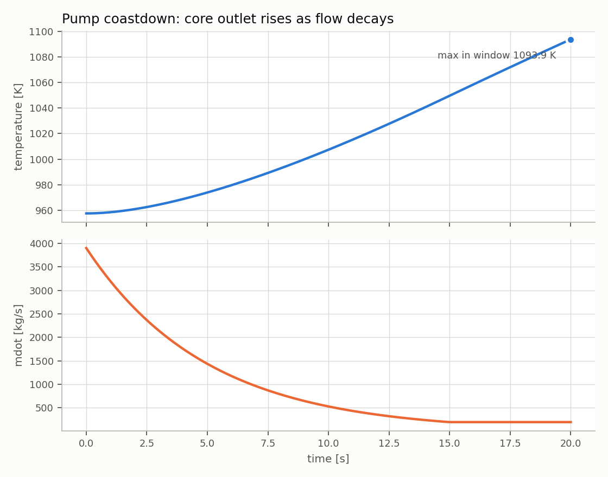

# thermosys — Water Rankine and FLiBe Coolant Loop Simulator

Modular Python models of a two-phase water Rankine power cycle and a single-phase molten-salt
(FLiBe) coolant loop, steady-state and transient, plus the coupled fusion-style plant in which
the FLiBe primary drives a reheat steam cycle.

Water properties come from CoolProp (IAPWS-95). FLiBe properties come from published
correlations (Sohal/INL, Attarian). The core design rule is that **components never import
CoolProp**: they talk to an abstract `Fluid`, so switching water for FLiBe is a fluid swap
rather than a rewrite.

## Capabilities

- **Steam cycles:** simple, reheat and regenerative (one open feedwater heater) Rankine cycles,
  with pump/turbine isentropic efficiencies and a reheat-pressure optimisation sweep
- **FLiBe loop:** pump → core → counterflow heat exchanger → return, closed by root-finding on the
  return temperature; heat-transfer coefficient from Dittus–Boelter using the coolant's own properties
- **Coupled plant:** FLiBe primary supplying both boiler and reheater duty to the steam cycle
- **Transients:** lumped control-volume networks integrated with BDF: power step, flow step,
  pump coastdown, loss of heat sink
- **Moving-boundary boiler:** finite-volume once-through boiler whose subcooled, two-phase and
  superheated zone lengths are diagnosed from the enthalpy field, and stay well defined when a zone vanishes
- **Exergy analysis:** flow exergy and component exergy destruction
- **Uncertainty propagation:** FLiBe property bands pushed through the loop to the return temperature

## Headline results

| Case | Result |
|---|---|
| Reheat cycle, ideal (8 MPa / 500 °C, reheat, 10 kPa) | η = 0.4084 |
| Optimum reheat pressure (swept) | 1.844 MPa, η = 0.4100 |
| Regenerative cycle, one open FWH | η = 0.4212, extraction fraction y = 0.215 |
| FLiBe loop, 500 MW | T_return = 903.7 K, core rise 53.75 K, freeze margin 171.7 K |
| Coupled plant (UA = 2.5 MW/K) | W_net = 204.1 MW, η_plant = 0.4081 |
| Loss-of-heat-sink transient | heat-up slope 1.496827 K/s, matches the analytic Q/(M·cp) |
| FLiBe property uncertainty | return temperature spread 30 K, dominated by conductivity and viscosity |

Full tables are in [docs/RESULTS.md](docs/RESULTS.md).

<p align="center">
  
  
</p>

## Verification

Verification, validation and uncertainty are kept separate. See [VERIFICATION.md](VERIFICATION.md).

- **134 tests**, anchored to independently computed and third-party published values
- **Mutation testing:** [`tools/mutation_check.py`](tools/mutation_check.py) deletes each of
  34 physics terms in turn and records the test that catches it. All 34 are caught, recorded in
  [FALSIFIABILITY.md](FALSIFIABILITY.md)
- **Independent formulation:** every cycle recomputed from scratch on IAPWS-IF97 without
  importing `thermosys`. Worst deviation is 3.1 × 10⁻⁴
- **Published values:** four textbook reheat and Rankine state points reproduced to within
  0.5 kJ/kg / 0.4 % quality
- **Limitation:** the FLiBe side has not been compared against loop experiments. Its uncertainty is
  quantified rather than validated.

## Installation

Requires Python ≥ 3.10.

```bash
git clone https://github.com/carlo432/thermosys-rankine-flibe.git
cd thermosys-rankine-flibe
pip install -e .
pip install pytest
```

## Usage

```bash
python3 -m pytest -q                              # test suite
python3 tools/mutation_check.py                   # regenerate FALSIFIABILITY.md
python3 validation/cross_check_if97.py            # independent IF97 cross-check
python3 runs/run_steady_sweeps.py                 # reheat-pressure and UA sweeps
python3 runs/run_transient_scenarios.py           # four transient scenarios
python3 runs/run_boiler_and_uncertainty.py        # moving-boundary boiler + FLiBe uncertainty
```

Each run script writes a CSV and PNG into `runs/`.

## Repository layout

| Path | Contents |
|---|---|
| `thermosys/fluids/` | `WaterFluid` (CoolProp), `FlibeFluid` (correlations), `ConstantCpFluid` |
| `thermosys/components/` | pump, turbine, boiler, condenser, counterflow HX, heat source |
| `thermosys/cycles/` | Rankine, reheat, regenerative, FLiBe loop, coupled plant |
| `thermosys/transient/` | lumped control-volume models, moving-boundary boiler |
| `thermosys/analysis/` | exergy, FLiBe property uncertainty propagation |
| `tests/` | pytest suite |
| `tools/` | mutation-testing harness |
| `validation/` | independent IAPWS-IF97 cross-check |
| `runs/` | scenario and sweep scripts with their CSV/PNG output |
| `docs/` | detailed results and modeling notes |

## Acknowledgements

AI coding assistants were used to help with implementation and to independently check results.

## License

MIT. See [LICENSE](LICENSE).
